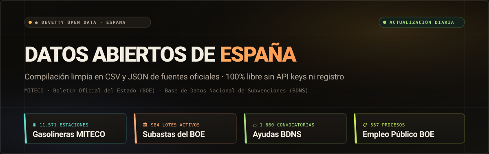
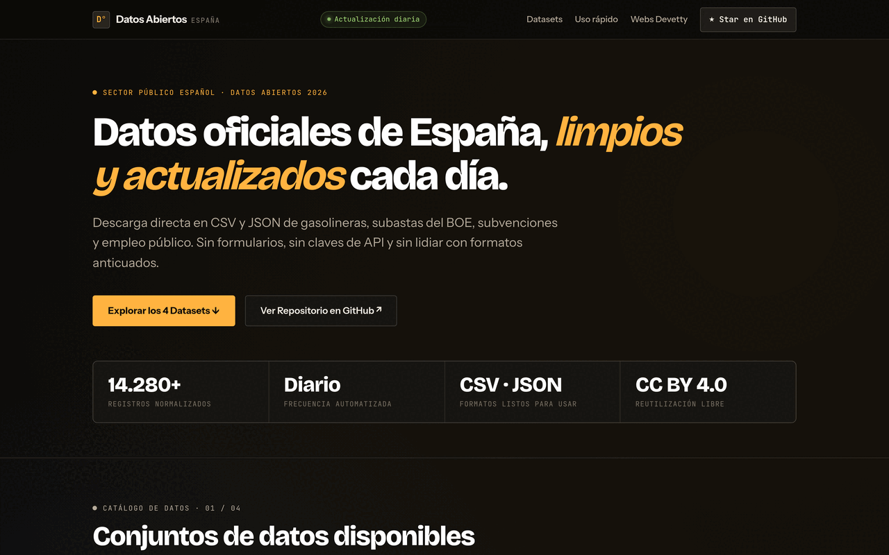

<p align="center">
  <a href="https://pablotheblink.github.io/datos-abiertos-espana/">
    
  </a>
</p>

<p align="center">
  <a href="https://github.com/PabloTheBlink/datos-abiertos-espana/stargazers"></a>
  
  
  
  
  
</p>

<p align="center">
  <strong>Los principales conjuntos de datos públicos de España, limpios, normalizados y actualizados a diario.</strong><br>
  Listos para análisis en Pandas, ingesta en bases de datos o prototipado de aplicaciones sin lidiar con formatos cerrados ni sedes electrónicas obsoletas.
</p>

<p align="center">
  <a href="https://pablotheblink.github.io/datos-abiertos-espana/"><strong>🌐 Visitar la Web y Explorador Online →</strong></a>
</p>

<p align="center">
  <a href="https://pablotheblink.github.io/datos-abiertos-espana/">
    
  </a>
</p>

---

## 🎯 ¿Por qué este repositorio?

Obtener datos abiertos del sector público en España a menudo requiere:
- ❌ Descargar ficheros XML gigantescos de sedes electrónicas con certificados caducados.
- ❌ Parsear PDFs y tablas maquetadas del Boletín Oficial del Estado.
- ❌ Registrarse en portales ministeriales para obtener tokens de API con cuotas estrictas.
- ❌ Encontrarse servicios caídos o formatos sin normalizar (coordenadas en proyecciones antiguas, fechas inconsistentes, caracteres rotos).

**Datos Abiertos de España** automatiza la extracción, limpieza y validación diaria de las fuentes públicas oficiales más demandadas. Cada noche, nuestros crawlers procesan las fuentes del Estado y publican datasets limpios en **CSV (UTF-8 con BOM)** y **JSON** listos para consumir en una línea de código.

- ⚡ **Zero Setup:** Sin registro, sin API keys, sin cabeceras de autorización.
- 🔄 **Actualización diaria:** Sincronizado cada madrugada con las sedes oficiales.
- 🧼 **Estandarizado:** Números decimales limpios, coordenadas WGS84 (latitud/longitud), fechas en estándar ISO y campos tipados.
- 📦 **Dualidad CSV + JSON:** Ideal tanto para análisis exploratorio en Jupyter/Excel como para consumo en microservicios o frontend.

---

## 📊 Catálogo de Datasets

Todos los conjuntos de datos se encuentran en carpetas dedicadas dentro del repositorio con sus versiones en CSV y JSON:

| Conjunto de Datos | Registros | Frecuencia | Fuente Oficial | Enlaces Directos | Web de Consulta |
|---|---:|---|---|---|---|
| **⛽ Gasolineras de España**<br>Estaciones de servicio con dirección, ubicación y precios de carburantes comunicados a la fuente pública. Los precios pueden cambiar desde su última actualización. | **11.558** | **Diaria (L-D)** | [Ministerio para la Transición Ecológica](https://geoportalgasolineras.es/) | [CSV](./gasolineras/gasolineras.csv) · [JSON](./gasolineras/gasolineras.json)<br>([Raw CSV](https://raw.githubusercontent.com/PabloTheBlink/datos-abiertos-espana/main/gasolineras/gasolineras.csv)) | [Gasolineras de España ↗](https://fuelspot.devetty.es?utm_source=github&utm_medium=readme&utm_campaign=datos-abiertos-espana) |
| **🏛️ Subastas del BOE**<br>Anuncios de subastas públicas con información del bien, organismo, fechas y valores publicados. Los detalles y condiciones corresponden a la fuente oficial. | **789** | **Diaria (Días hábiles)** | [Portal de Subastas del BOE](https://subastas.boe.es/) | [CSV](./subastas/subastas.csv) · [JSON](./subastas/subastas.json)<br>([Raw CSV](https://raw.githubusercontent.com/PabloTheBlink/datos-abiertos-espana/main/subastas/subastas.csv)) | [Subastas del BOE ↗](https://subastas.devetty.es?utm_source=github&utm_medium=readme&utm_campaign=datos-abiertos-espana) |
| **💶 Subvenciones y ayudas**<br>Convocatorias de ayudas públicas con organismo convocante, importes, finalidad y plazos disponibles. La vigencia y las condiciones se consultan en la fuente oficial. | **1.453** | **Diaria (Días hábiles)** | [BDNS (Ministerio de Hacienda)](https://www.infosubvenciones.es/) | [CSV](./subvenciones/subvenciones.csv) · [JSON](./subvenciones/subvenciones.json)<br>([Raw CSV](https://raw.githubusercontent.com/PabloTheBlink/datos-abiertos-espana/main/subvenciones/subvenciones.csv)) | [Subvenciones y ayudas ↗](https://subvenciones.devetty.es?utm_source=github&utm_medium=readme&utm_campaign=datos-abiertos-espana) |
| **📋 Convocatorias de empleo público**<br>Convocatorias de empleo público publicadas en el BOE, con puestos, plazas, ámbito y plazos de presentación cuando están disponibles. La publicación oficial prevalece para consultar sus bases. | **480** | **Diaria (Días hábiles)** | [Boletín Oficial del Estado](https://www.boe.es/) | [CSV](./oposiciones/oposiciones.csv) · [JSON](./oposiciones/oposiciones.json)<br>([Raw CSV](https://raw.githubusercontent.com/PabloTheBlink/datos-abiertos-espana/main/oposiciones/oposiciones.csv)) | [Convocatorias de empleo público ↗](https://oposiciones.devetty.es?utm_source=github&utm_medium=readme&utm_campaign=datos-abiertos-espana) |

*Última actualización sincronizada: 2026-11-24 (UTC) · Total de registros normalizados: 14.280.*

---

## 🚀 Uso Rápido en 3 Líneas

Puedes descargar o consumir los datos directamente sin clonar el repositorio, utilizando los enlaces `raw.githubusercontent.com`.

### 1. Terminal / `curl`

Descarga cualquier dataset en segundos:

```bash
# Descargar gasolineras actualizadas de hoy en CSV
curl -sL https://raw.githubusercontent.com/PabloTheBlink/datos-abiertos-espana/main/gasolineras/gasolineras.csv -o gasolineras.csv

# Descargar las subastas activas del BOE en JSON
curl -sL https://raw.githubusercontent.com/PabloTheBlink/datos-abiertos-espana/main/subastas/subastas.json -o subastas.json
```

### 2. Python (Pandas)

Carga y explora los datos en memoria en 3 líneas:

```python
import pandas as pd

# Cargar directamente el CSV de gasolineras
url = "https://raw.githubusercontent.com/PabloTheBlink/datos-abiertos-espana/main/gasolineras/gasolineras.csv"
df = pd.read_csv(url)

# Filtrar las 5 gasolineras más baratas de Diésel en Madrid
baratas = df[df["provincia_name"] == "Madrid"].sort_values("price_diesel_a")[["brand_title", "municipio_name", "price_diesel_a"]].head(5)
print(baratas)
```

### 3. JavaScript / Node.js (Fetch nativo)

Consume los datos en tu API o aplicación web:

```javascript
// Obtener subvenciones activas directamente de GitHub
const res = await fetch("https://raw.githubusercontent.com/PabloTheBlink/datos-abiertos-espana/main/subvenciones/subvenciones.json");
const ayudas = await res.json();

console.log(`Convocatorias abiertas: ${ayudas.length}`);
console.log("Primera convocatoria:", ayudas[0].descripcion, ayudas[0].importe);
```

### 4. DuckDB / SQL en línea

Consulta los datos sin descargar nada en local:

```sql
-- Analizar la distribución de plazas de empleo público por grupo profesional
SELECT grupo, SUM(CAST(plazas AS INTEGER)) AS total_plazas
FROM 'https://raw.githubusercontent.com/PabloTheBlink/datos-abiertos-espana/main/oposiciones/oposiciones.csv'
WHERE plazas IS NOT NULL AND plazas != ''
GROUP BY grupo
ORDER BY total_plazas DESC;
```

---

## 📐 Estructura y Esquema de Campos

<details>
<summary><strong>🔍 Ver esquema detallado de cada dataset (clic para desplegar)</strong></summary>

<br>

### ⛽ Gasolineras (`gasolineras.csv` / `gasolineras.json`)
- `station_id`: Identificador único del Ministerio.
- `brand_title`: Nombre comercial / bandera (Repsol, Cepsa, BP, Plenoil, etc.).
- `address`: Dirección postal de la estación.
- `postal_code`: Código postal de 5 dígitos.
- `municipio_name`: Municipio.
- `provincia_name`: Provincia de ubicación.
- `latitude` / `longitude`: Coordenadas geográficas en WGS84 decimales.
- `horario`: Horario de apertura comunicado.
- `price_gasoline_95_e5`: Precio en €/litro de Gasolina 95 E5.
- `price_gasoline_98_e5`: Precio en €/litro de Gasolina 98 E5.
- `price_diesel_a`: Precio en €/litro de Gasóleo A habitual.
- `source_updated_at`: Marca de tiempo comunicada por la estación.
- `station_slug`: Identificador de URL amigable.
- `url`: Ficha web en FuelSpot con mapa e histórico.

### 🏛️ Subastas del BOE (`subastas.csv` / `subastas.json`)
- `id`: Identificador oficial del anuncio de subasta en el BOE.
- `organismo`: Juzgado, notaría u órgano de recaudación convocante.
- `estado`: Estado del trámite (Celebrándose, Próxima, etc.).
- `fecha_inicio` / `fecha_conclusion`: Fechas de apertura y cierre de pujas.
- `tipo_bien_label`: Categoría (Inmueble, Vehículo, Maquinaria, etc.).
- `descripcion_corta`: Resumen del lote o finca subastada.
- `direccion` / `provincia`: Localización física del bien.
- `valor_subasta`: Valor de tasación oficial en euros.
- `puja_minima`: Importe mínimo de puja en euros (si aplica).
- `deposito`: Fianza requerida para participar en la puja.
- `url_boe`: Enlace directo al expediente en subastas.boe.es.
- `slug` / `url`: Ficha detallada en la web de Subastas.

### 💶 Subvenciones y Ayudas (`subvenciones.csv` / `subvenciones.json`)
- `id` / `numero_convocatoria`: Código oficial en la Base de Datos Nacional de Subvenciones.
- `descripcion`: Título y objeto de la ayuda o subvención.
- `fecha_recepcion`: Fecha de registro en la BDNS.
- `organismo`: Entidad o ministerio convocante.
- `nivel1` / `nivel2`: Jerarquía administrativa (Administración Central / CCAA / Entidades Locales).
- `importe`: Presupuesto total asignado a la convocatoria (en euros).
- `beneficiario`: Perfil elegible (Pymes, autónomos, particulares, asociaciones, etc.).
- `finalidad`: Clasificación temática (Investigación, Empleo, Transición Ecológica, Cultura...).
- `fecha_inicio_solicitud` / `fecha_fin_solicitud`: Plazos oficiales de presentación.
- `url_bdns`: Expediente oficial en infosubvenciones.es.
- `slug` / `url`: Ficha detallada en la web de Subvenciones.

### 📋 Oposiciones y Empleo Público (`oposiciones.csv` / `oposiciones.json`)
- `identificador`: Código de referencia del proceso selectivo en el BOE.
- `titulo`: Denominación de la convocatoria oficial.
- `fecha_publicacion`: Fecha de publicación en el Boletín Oficial del Estado.
- `departamento`: Ministerio, organismo público o administración convocante.
- `tipo_proceso`: Concurso, oposición o concurso-oposición.
- `acceso`: Libre o promoción interna.
- `plazas`: Número total de plazas convocadas.
- `cuerpo_escala`: Cuerpo o escala funcionarial.
- `grupo`: Subgrupo de clasificación profesional (A1, A2, C1, C2, Otras).
- `plazo_presentacion`: Descripción del plazo oficial (ej. "20 días hábiles").
- `fecha_fin_estimada`: Fecha límite estimada para entregar solicitudes.
- `resumen`: Descripción sucinta de las funciones y ámbito.
- `url_html`: Enlace directo a la resolución oficial publicada en boe.es.
- `slug` / `url`: Ficha completa en la web de Oposiciones.

</details>

---

## 🤖 ¿Cómo se actualiza este repositorio?

Este repositorio es **100% desatendido**:
1. **Extracción y filtrado:** Un orquestador programado de scraping consulta diariamente las APIs y feeds oficiales de MITECO, BOE y BDNS.
2. **Validación y tipado:** Se descartan registros corruptos, se sanean caracteres especiales y se normalizan campos numéricos y fechas.
3. **Generación multi-formato:** Se construyen los archivos CSV (con codificación UTF-8 BOM para apertura directa en Excel sin problemas de tildes) y JSON estructurados.
4. **Publicación automática:** Se actualizan las páginas provinciales de GitHub Pages y se hace commit y push directo a la rama `main`.

---

## ⚖️ Licencia y Atribución

- **Fuentes oficiales:** Los datos originales proceden de fuentes públicas de la Administración General del Estado:
  - Gasolineras: [Ministerio para la Transición Ecológica (MITECO)](https://geoportalgasolineras.es/)
  - Subastas: [Portal de Subastas del Boletín Oficial del Estado](https://subastas.boe.es/)
  - Subvenciones: [Base de Datos Nacional de Subvenciones (BDNS · Ministerio de Hacienda)](https://www.infosubvenciones.es/)
  - Empleo público: [Boletín Oficial del Estado (BOE)](https://www.boe.es/)
- **Reutilización:** La reutilización de los datos se realiza conforme a la [Ley 37/2007, de 16 de noviembre, sobre reutilización de la información del sector público](https://www.boe.es/buscar/act.php?id=BOE-A-2007-19814) y las condiciones de cada fuente pública emisora, citando siempre la fuente de origen.

---

## ⚡ Hecho por Devetty

Este repositorio forma parte de la red de proyectos y microaplicaciones de datos públicos de **[Devetty](https://devetty.es)**, enfocada en hacer accesible la información pública compleja para ciudadanos y empresas:

- **[FuelSpot](https://fuelspot.devetty.es?utm_source=github&utm_medium=readme&utm_campaign=datos-abiertos-espana)**: Comparador de precios de carburante en tiempo real con mapas y alertas por gasolinera.
- **[Subastas Devetty](https://subastas.devetty.es?utm_source=github&utm_medium=readme&utm_campaign=datos-abiertos-espana)**: Buscador inteligente de subastas judiciales, inmuebles y vehículos del BOE.
- **[Subvenciones Devetty](https://subvenciones.devetty.es?utm_source=github&utm_medium=readme&utm_campaign=datos-abiertos-espana)**: Radar de ayudas públicas, subvenciones y fondos europeos para pymes y autónomos.
- **[Oposiciones Devetty](https://oposiciones.devetty.es?utm_source=github&utm_medium=readme&utm_campaign=datos-abiertos-espana)**: Directorio actualizado de empleo público y convocatorias del Estado.
- **[LicitacionesAlerta](https://licitacionesalerta.es?utm_source=github&utm_medium=readme&utm_campaign=datos-abiertos-espana)**: Monitor y alertas diarias de contratación pública de la PLACSP.
- **[Actores de Scrapers en Apify](https://apify.com/pablotheblink?utm_source=github&utm_medium=readme&utm_campaign=datos-abiertos-espana)**: Actores listos para producción para extraer licitaciones de PLACSP y TED Europa a escala.

---

<p align="center">
  <strong>¿Te resulta útil este proyecto?</strong><br>
  Dale una estrella ⭐ en GitHub para apoyar el mantenimiento continuo y la incorporación de nuevos datasets públicos.
</p>
<p align="center">
  <a href="https://github.com/PabloTheBlink/datos-abiertos-espana/stargazers">
    
  </a>
</p>
